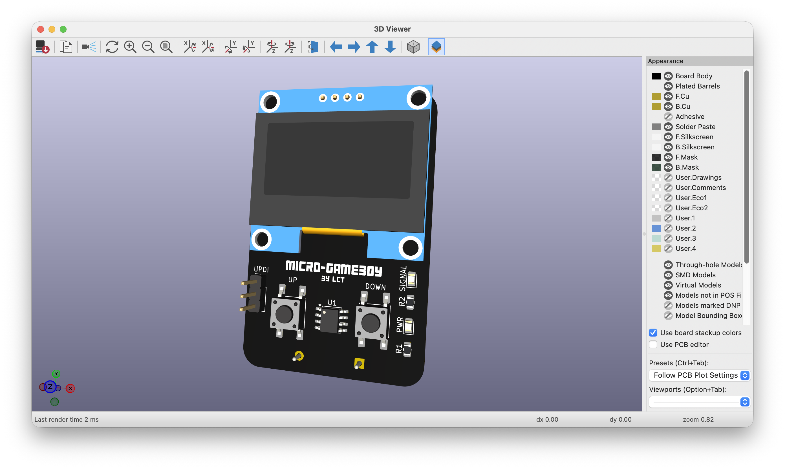

## Log entry 1

**Date:** 16 November 2026

I created the schematic for the Micro-Gameboy project. I also created the pin assignment table to document how the microcontroller pins are connected to the different components in the circuit.

## Log entry 2

**Date:** 17 November 2026

I created the PCB layout from the schematic and placed all of the components on the board. I then routed the circuit using FreeRouting to complete the electrical connections between the components.

## Log entry 3

**Date:** 17 November 2026

I modified the 3D file for the project and added the text **“Micro-Gameboy”** to the design.

## Log entry 4

**Date:** 18 November 2026

I added the bill of materials (BOM) for the project, listing the components required to build the Micro-Gameboy.

**BOM:** [View the CSV BOM file](micro-gameboy-attiny412.csv)