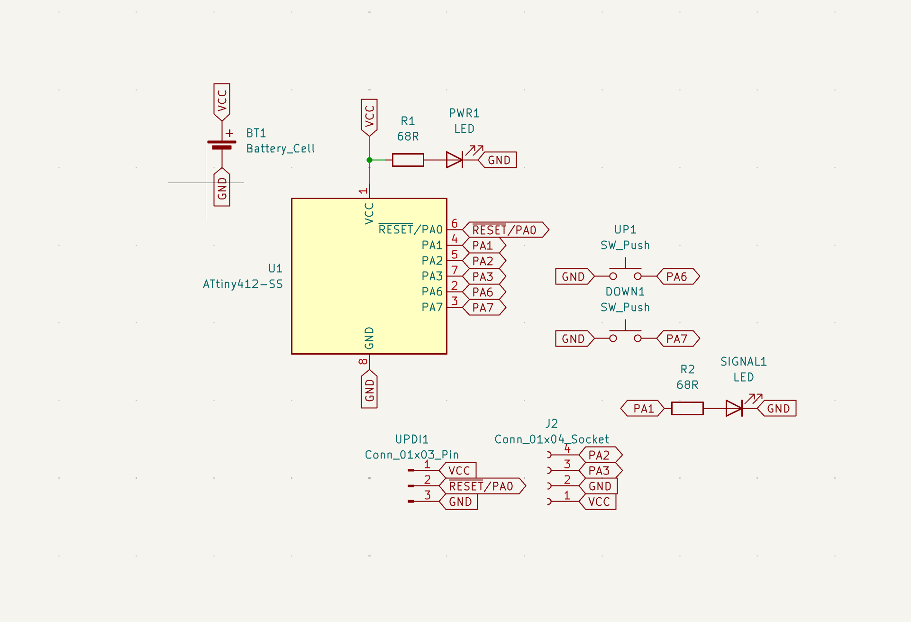
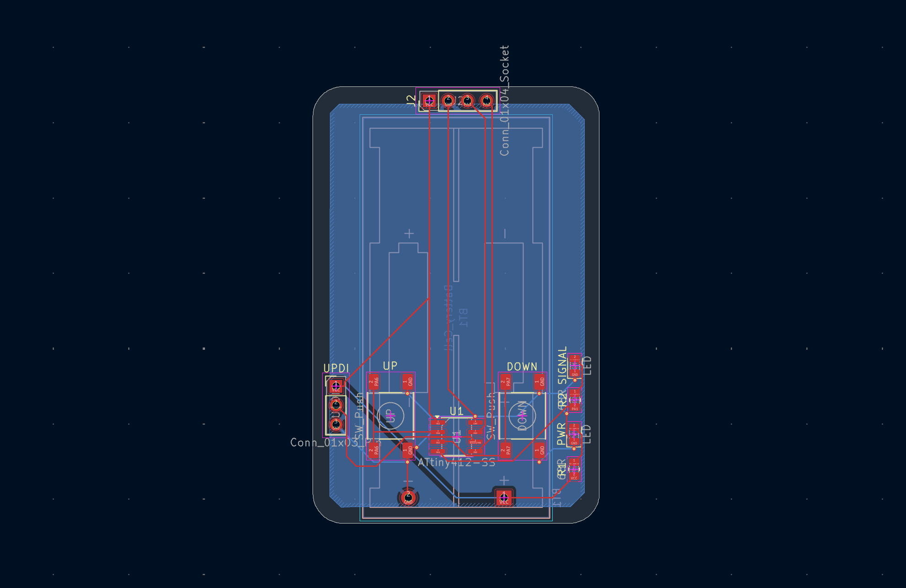

# Micro Gameboy

A pocket-size gaming console powered by the **ATtiny412**, preloaded with the classic **Flappy Bird** game.

Designed around a compact custom PCB, Micro Gameboy features a monochrome I²C OLED display, two physical control buttons, and a simple battery-powered architecture using two AAA batteries.

More than just a miniature gaming console, it is designed to support compatible custom games that can be flashed directly through its **UPDI programming port**.

---

## Features

- **ATtiny412 Microcontroller** — Compact AVR microcontroller powering the console.
- **OLED Display** — Monochrome I²C display for game graphics and interface.
- **Two-Button Control** — Simple physical controls for gameplay.
- **AAA Battery Powered** — Operates using two standard AAA batteries.
- **UPDI Programming** — Flash compatible custom games through the UPDI interface.
- **Custom PCB** — Designed and developed using KiCad.

## Hardware

| Component       | Description         |
| --------------- | ------------------- |
| Microcontroller | ATtiny412           |
| Display         | I²C Monochrome OLED |
| Input           | 2× Push Buttons     |
| Power           | 2× AAA Batteries    |
| Programming     | UPDI                |

## Gallery

### Schematics

### PCB Design

## Firmware & Games

Micro Gameboy comes preloaded with a recreation of the classic **Flappy Bird** game.

The ATtiny412's UPDI programming interface also allows compatible firmware and games to be flashed onto the microcontroller, opening the possibility for additional games and custom applications.

*Game compatibility depends on the available hardware resources, display interface, and firmware implementation.*

## PCB Design

The custom schematic and PCB layout are developed using **KiCad**.

Project design files and development documentation are maintained in this repository.

## Development Journal

Follow the project's engineering progress, design decisions, technical challenges, and development milestones in [`journal.md`](journal.md).

---
**Designed with love ❤️ by LCT2008**
